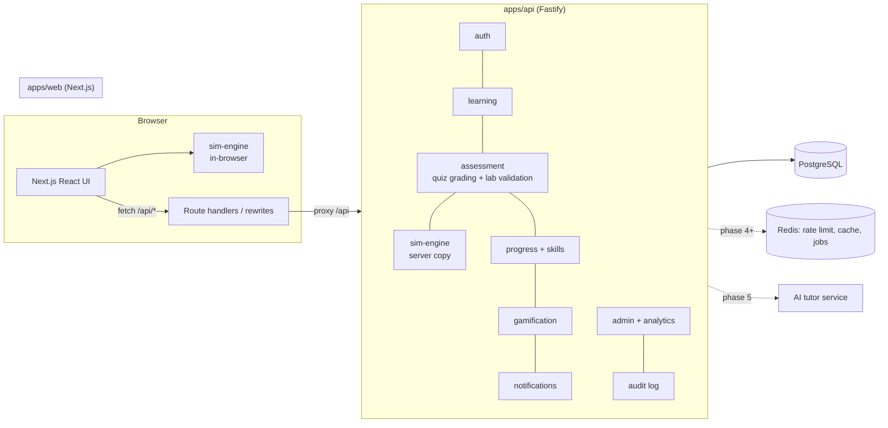
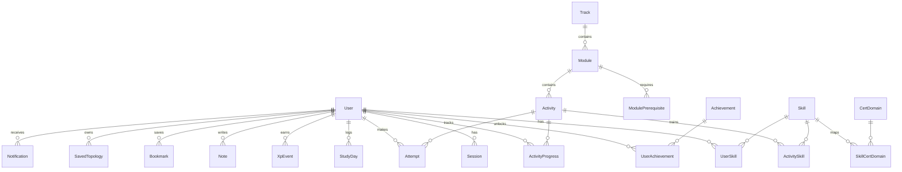

# NetForge Academy — Architecture

> Interactive networking learning platform: guided curriculum + deterministic network
> simulation engine + validated hands-on labs + personalised progress.

This document answers the 14 pre-build questions (product, system, data, simulation,
learning, frontend, admin, API, security, MVP, roadmap, complexity, infrastructure, risks).
Assumptions are marked **[A]**.

---

## 1. Product architecture

```
            ┌──────────────── Learning loop (every concept) ────────────────┐
            │ Learn → Visualize → Simulate → Practice → Break → Troubleshoot │
            │        → Understand → Test → Build a project                   │
            └────────────────────────────────────────────────────────────────┘

 Curriculum (Tracks → Modules → Activities)        Simulation engine (shared TS package)
   ├─ LESSON    : structured blocks, embedded sims    ├─ network state (devices, links, tables)
   ├─ QUIZ      : server-graded, explained answers    ├─ frame/packet event engine (ARP, L2, L3)
   ├─ LAB       : scenario + tasks + checks + hints   ├─ Cisco-style CLI + host shell
   ├─ CHALLENGE : troubleshoot / design / subnetting  ├─ diagnostics ("why doesn't it work?")
   └─ PROJECT   : multi-concept build, validated      └─ lab validator (runs client AND server)

 Learner model                                      Gamification (professional tone)
   ├─ ActivityProgress (status, best score, draft)    ├─ XP ledger, levels
   ├─ Attempts (score, hints, mistakes, time)         ├─ streaks from StudyDay
   ├─ UserSkill mastery: Not started → Learning →     ├─ achievements (rule-based criteria)
   │   Practicing → Competent → Mastered              └─ daily goal + generated daily plan
   └─ Cert mapping: Activity ↔ Skill ↔ CertDomain
```

Key product decisions

* **Activities are a single polymorphic concept** (LESSON/QUIZ/LAB/CHALLENGE/PROJECT) with a
  typed JSON `content` validated by Zod. One progress model, one attempt model, one player
  route — and admins can author any of them without code changes.
* **The simulator is a learning tool, not Packet Tracer.** Every embedded simulation has a
  stated learning goal, suggested actions, and a step-by-step "what happened here?" trace.
* **Errors teach.** A diagnostics pass converts misconfiguration into explanations
  ("your gateway 192.168.20.1 is not in your network 192.168.10.0/24").
* **Honest claims.** The curriculum builds beginner → advanced practical skill and maps to
  certification domains; it does not claim to make anyone an expert or replace official
  exam prep. All content is original.

---

## 2. System architecture



* **Same engine on both sides.** The browser runs the simulation for instant feedback;
  the API re-runs the *same deterministic engine* on the submitted topology to grade labs.
  Clients can never post a score — only a configuration, which the server evaluates.
* **Next.js proxies `/api/*`** to the API so auth cookies are first-party (`SameSite=Lax`),
  no CORS surface, and the API can be scaled/deployed independently.
* **No learner command ever reaches a real shell.** The CLI is a parser over an in-memory
  data structure (see §9).

Why this stack

| Choice | Reason |
|---|---|
| TypeScript everywhere | Engine shared by browser + server; one type system for content schemas |
| Next.js 15 (App Router) | SSR/SSG for SEO pages, client components for simulators, file routing |
| Fastify 5 | Fast, schema-friendly, plugin model fits module boundaries; separate from UI |
| PostgreSQL 16 | Relational integrity for progress/attempts + JSONB for content and topologies |
| Prisma | Typed queries, migrations, readable schema |
| React Flow (@xyflow/react) | Mature node/edge canvas: drag, zoom, custom nodes, virtualised rendering |
| Zustand + TanStack Query | Local simulator state vs. cached server state, clearly separated |
| Zod | One validation layer for API input, content JSON and untrusted topologies |
| Vitest + Playwright | Fast unit tests for engine; E2E for critical flows |
| pnpm workspaces | `packages/sim-engine`, `packages/content`, `apps/web`, `apps/api` |

---

## 3. Database design

Normalisation: 3NF for identity, curriculum structure, progress and gamification.
JSONB is used *deliberately* for (a) activity content — heterogeneous, versioned,
always read whole and validated by Zod; (b) topologies — a graph always loaded/saved
atomically, never queried per node. **[A]** Separate `TopologyNodes/TopologyEdges` tables
were considered and rejected: they add joins and write amplification for every drag with
no query that needs them. If cross-topology analytics are needed later, a materialised
view can project JSONB to rows.



| Table | Key columns | Constraints / indexes |
|---|---|---|
| User | id (cuid), email, passwordHash, displayName, role, xp, dailyGoalMinutes, experience | `email` unique |
| Session | id, tokenHash, userId, expiresAt, ip, userAgent | `tokenHash` unique, idx(userId), cascade on user delete |
| Track | id, slug, title, description, order, kind (CORE / MIKROTIK) | `slug` unique |
| Module | id, slug, trackId, title, summary, level, order, estMinutes, published | `slug` unique, idx(trackId, order) |
| ModulePrerequisite | moduleId, requiresId | PK(moduleId, requiresId), check moduleId≠requiresId (app-level) |
| Activity | id, slug, moduleId, type, title, summary, order, estMinutes, difficulty, xp, content JSONB, version, published | `slug` unique, idx(moduleId, order) |
| Skill | id, slug, name, domain | `slug` unique |
| ActivitySkill | activityId, skillId, weight | PK(activityId, skillId) |
| CertDomain | id, cert (CCNA/MTCNA/FUND), code, title | unique(cert, code) |
| SkillCertDomain | skillId, certDomainId | PK |
| ActivityProgress | userId, activityId, status, bestScore, attempts, timeSpentSec, draft JSONB, completedAt, lastSeenAt | unique(userId, activityId), idx(userId, status) |
| Attempt | id, userId, activityId, score, passed, durationSec, hintsUsed, mistakes, result JSONB, createdAt | idx(userId, activityId), idx(activityId, createdAt) — analytics |
| UserSkill | userId, skillId, score 0–100, evidence, lastPracticedAt | PK(userId, skillId) |
| StudyDay | userId, day (date), minutes, xp | PK(userId, day) — streaks & goals in O(days) |
| XpEvent | id, userId, amount, reason, activityId?, createdAt | idx(userId, createdAt) — immutable ledger, `User.xp` is a cache |
| Achievement / UserAchievement | slug, title, criteria JSONB / PK(userId, achievementId) | |
| Note | id, userId, activityId?, body, timestamps | idx(userId, updatedAt) |
| Bookmark | userId, activityId, createdAt | PK(userId, activityId) |
| SavedTopology | id, userId, name, data JSONB, timestamps | idx(userId, updatedAt) |
| Notification | id, userId, type, title, body, readAt | idx(userId, readAt) |
| AuditLog | id, actorId, action, entity, entityId, meta JSONB, createdAt | idx(entity, entityId), idx(createdAt) |

Mastery state is **derived** from `UserSkill.score` (0 / <40 / <70 / <90 / ≥90) so
thresholds can change without data migration. The authoritative Prisma schema is
`apps/api/prisma/schema.prisma`.

---

## 4. Simulation-engine architecture (`packages/sim-engine`)

Pure TypeScript, zero DOM/Node dependencies, deterministic (no `Math.random`, no clocks;
MACs come from a counter in the network document).

```
Network (JSON-serialisable document, version 1)
 ├─ devices: Device[]
 │   ├─ kind: pc | laptop | server | switch | router
 │   ├─ interfaces: Iface[]   name, mac, adminUp, ip/prefix,
 │   │                         switchport {mode, accessVlan, allowedVlans, nativeVlan},
 │   │                         parent + dot1q (router sub-interfaces)
 │   ├─ gateway (hosts), staticRoutes (routers), vlans (switches)
 │   └─ runtime: arp[] (L3 devices), macTable[] (switches)
 ├─ links: { id, a:{device,iface}, b:{device,iface} }
 └─ macCounter
```

Engine layers

1. **`ip.ts`** – IPv4 math: parse/format, masks↔prefix, network/broadcast, ranges, binary
   views, address classification, subnet split, VLSM planner, seeded challenge generator.
2. **`network.ts`** – topology operations (add/remove/rename device, connect, set IP...),
   all pure functions over a draft (`produce(net, fn)` = structured clone + mutate).
3. **`sim.ts`** – discrete event simulator. Units of work are *frame deliveries* over links,
   processed FIFO with a `tick` (hop depth) used by the UI for animation:
   * **Hosts/routers (L3):** logical-interface dispatch (802.1Q sub-interfaces), ARP
     request/reply with pending-packet queues, local delivery, longest-prefix-match routing
     (connected AD 0, static AD 1, recursive next hop), TTL decrement, ICMP echo / time
     exceeded / unreachable.
   * **Switches (L2):** ingress VLAN classification (access/trunk/native/allowed), VLAN
     existence, MAC learning per (VLAN, port), known-unicast forwarding, flooding,
     egress tagging.
   * **Safety:** hard cap on processed frames → reports a *broadcast storm* (teaches why
     STP exists) instead of hanging the browser.
   * Every decision emits a `SimEvent { tick, kind, deviceId, linkId, frame, message }`
     — the "what happened here?" narration and animation script.
4. **`routing.ts`** – routing table builder (`show ip route`), LPM lookup.
5. **`cli/`** – IOS-style modal CLI (`>`, `#`, `(config)#`, `(config-if)#`, `(config-vlan)#`)
   with unique-prefix keyword abbreviation and `?` help; host shell (`ipconfig`, `ping`,
   `tracert`, `arp -a`). Output is rendered *from state*, never canned.
6. **`diagnose.ts`** – static analysis producing teaching explanations: gateway outside
   subnet, duplicate IPs, shutdown interfaces, unconnected ports, access port in missing
   VLAN, trunk/access mismatch, native VLAN mismatch, overlapping router subnets, missing
   routes.
7. **`validate.ts`** – declarative lab checks (`ping`, `hostConfig`, `interfaceIp`,
   `interfaceUp`, `vlanExists`, `portAccessVlan`, `portMode`, `trunkAllows`, `routeExists`,
   `deviceCount`, `pingMatrix`). Runs on a clone with fresh runtime tables so results do
   not depend on prior learner actions.
8. **`spec.ts`** – compact authoring format (`TopologySpec`) → `Network`, used by content.

Phase 4 additions plug in as new device processors / packet types with the same event
model: DHCP (DORA over broadcast), DNS (resolver chain), NAT/PAT (translation table on
router egress), STP (BPDU exchange, port roles, convergence timeline), OSPF (hello,
adjacency FSM, LSDB, SPF), IPv6 (NDP instead of ARP).

---

## 5. Learning-path architecture

```
Track (CORE, MIKROTIK)
 └─ Module (level 0..N, prerequisites: Module[])
     └─ Activity (ordered; type LESSON | QUIZ | LAB | CHALLENGE | PROJECT)
         ├─ content (typed JSON)
         └─ ActivitySkill → Skill → SkillCertDomain → CertDomain (CCNA / MTCNA / Fundamentals)
```

* **Unlocking:** a module is unlocked when every prerequisite module is *complete*.
  Complete = all activities completed, **or** all of its QUIZ activities passed at ≥ 80 %
  (**test-out**). Checkpoint quizzes are always accessible so advanced learners can skip.
* **Evidence → mastery:** each graded attempt updates `UserSkill.score` with an
  exponentially weighted average (`new = old*(1-w) + score*w`, `w = 0.35 × skill weight`),
  lessons contribute a small "exposure" bump. Hints reduce lab score (−10 % each).
* **Recommendations & daily plan:** next unfinished activity on the path + the weakest
  practiced skills (lowest score with evidence) + a review item, packed into the user's
  daily goal minutes.
* **Curriculum mapping** (Topic → Skill → Lab → Assessment → Cert domain) is a query over
  the join tables, rendered on the Skill Map page.

---

## 6. Frontend architecture (`apps/web`)

```
app/
 (public)/            page.tsx (landing, live sim hero) · curriculum · about · login · register
 app/                 layout (sidebar shell, auth guard)
   page.tsx           dashboard: goal ring, streak, next up, daily plan, weak/strong skills
   path/              learning path map (levels, locks, progress)
   modules/[slug]/    module overview
   learn/[slug]/      activity player → LessonPlayer | QuizPlayer | LabPlayer | SubnetChallenge
   lab/               sandbox simulator (save/load topologies)
   subnetting/        visual subnet trainer + generated practice
   skills/            skill map + certification mapping
   achievements/      badges, XP, level
   notes/             notes + bookmarks
   settings/          profile, daily goal, theme
 admin/               dashboard · content (tracks/modules/activities, block editor) · users · analytics · audit
components/
 sim/                 Simulator (canvas, palette, config panel, terminal, packet inspector,
                      event log, controls, validation panel), DeviceNode, LinkEdge
 lesson/              block renderers (text, term, callout, topology, encapsulation,
                      subnet-explorer, binary, inline check, osi stack)
 ui/                  Button, Card, Badge, Progress, Tabs, Dialog, EmptyState, Spinner...
lib/                  api client (typed fetch), query hooks, auth context, theme
stores/               simulator store (zustand): network, selection, events, playback
```

* Server state: TanStack Query (cache keys per resource; mutations invalidate).
* Simulator state: Zustand store per simulator instance (created via context so lessons can
  embed several independent simulators).
* Heavy simulation runs synchronously (typical labs < 5 ms); a Web Worker wrapper is in the
  roadmap for >100-device sandboxes.
* Mobile: lessons, quizzes, dashboard and subnetting are fully responsive. The topology
  builder shows a read-only/pan view with a "best on desktop" notice instead of a cramped
  editor.

---

## 7. Admin architecture

* **Content:** CRUD for tracks, modules (incl. prerequisites), activities. Activity editor
  = metadata form + block list editor (add / reorder / delete blocks, per-block JSON with
  live Zod validation) + preview using the real player. Publishing toggles visibility.
* **Users:** search, role change (ADMIN / INSTRUCTOR / STUDENT), per-user progress.
* **Analytics:** per activity — attempts, pass rate, average score, average hints,
  drop-off (started vs completed); most failed lab checks ("common configuration
  mistakes"); hardest skills.
* **Audit log:** every admin mutation recorded (actor, action, entity, diff summary).

---

## 8. API architecture (REST, JSON, `/api/v1`)

Errors: `{ error: { code, message, details? } }` with 400 validation, 401 unauthenticated,
403 forbidden, 404 not found, 409 conflict, 429 rate limited, 500 internal.

| Method | URL | Auth | Request | Response |
|---|---|---|---|---|
| POST | /auth/register | – | email, password (≥10), displayName | user (sets cookie); 409 email taken |
| POST | /auth/login | – | email, password | user; 401 bad credentials; 429 |
| POST | /auth/logout | user | – | 204 |
| GET | /auth/me | optional | – | user or null |
| GET | /curriculum | optional | – | tracks → modules → activity summaries (+ progress/locks if authed) |
| GET | /modules/:slug | user | – | module, activities, progress, lock reason |
| GET | /activities/:slug | user | – | activity (quiz answers & lab debriefs stripped), progress, bookmark |
| PUT | /activities/:slug/progress | user | { draft?, timeSpentSec?, status? } | progress |
| POST | /activities/:slug/complete | user | { durationSec } (lessons only) | progress, xp, achievements |
| POST | /activities/:slug/attempts | user | quiz: { answers }; lab: { network, hintsUsed, durationSec } | graded result, xp, achievements; 422 invalid topology |
| GET | /activities/:slug/attempts | user | – | user's attempt history |
| POST | /practice/subnetting | user | { seed, answers, durationSec } | graded result (server regenerates from seed) |
| GET | /me/dashboard | user | – | stats, streak, goal, next up, daily plan, skills |
| GET | /me/skills | user | – | skills with mastery + cert mapping |
| GET | /me/achievements | user | – | all achievements with earned flag, xp, level |
| PATCH | /me/settings | user | displayName?, dailyGoalMinutes? | user |
| POST | /me/heartbeat | user | { minutes (1–5) } | studyDay — rate limited |
| GET/POST/PATCH/DELETE | /me/notes[/:id] | user | body, activityId? | notes |
| GET/PUT/DELETE | /me/bookmarks[/:activityId] | user | – | bookmarks |
| GET/POST/PUT/DELETE | /me/topologies[/:id] | user | name, data (validated network) | topologies |
| GET/POST | /me/notifications, /me/notifications/read | user | ids? | notifications |
| GET/POST/PATCH/DELETE | /admin/tracks, /admin/modules, /admin/activities | admin | Zod-validated bodies | entities; 409 slug conflict |
| GET/PATCH | /admin/users[/:id] | admin | role | users (paginated, searchable) |
| GET | /admin/analytics | admin/instructor | – | aggregates |
| GET | /admin/audit | admin | page | audit entries |

---

## 9. Security architecture

| Concern | Control |
|---|---|
| Passwords | `scrypt` (Node crypto, N=2^15, per-user salt), constant-time compare |
| Sessions | 256-bit random token in `HttpOnly; SameSite=Lax; Secure(prod)` cookie; only SHA-256 hash stored; 30-day sliding expiry; revoked on logout |
| CSRF | SameSite=Lax + mutating requests must send `X-NF-Request: 1` header (not settable cross-site without CORS preflight, and CORS is disabled) + Origin check |
| AuthZ | Route-level guards (`requireUser`, `requireRole`) + ownership filters in every query (`where: { userId }`) |
| Validation | Zod on every body/param; topology documents limited (≤ 80 devices, ≤ 200 links, string lengths) before the engine sees them |
| Injection | Prisma parameterised queries only; no raw SQL with interpolation |
| XSS | React escaping; lesson markdown rendered with `react-markdown` (raw HTML disabled); CSP headers |
| Rate limiting | Global limit + strict limits on auth and attempts (`@fastify/rate-limit`; Redis store in prod) |
| Simulator isolation | The engine is a pure function over JSON. No `eval`, no shell, no network, no filesystem. Commands are tokenised and matched against a whitelist grammar. Frame processing is bounded (CPU cap) |
| Grading integrity | Server re-validates labs and grades quizzes; quiz answers never sent to the client before submission |
| Audit | Admin mutations + role changes logged |
| Secrets | `.env` locally, platform secret store in prod; never committed |
| Headers | `@fastify/helmet` + Next security headers |
| Uploads | None in MVP. Future: presigned S3 URLs, MIME sniffing, size limits, AV scan job |

---

## 10. MVP scope (what this repository implements)

✅ **Implemented in v0.1**

* Auth (register/login/logout, sessions, RBAC), seeded admin + demo student.
* Curriculum: 2 tracks, 12 modules with prerequisites, 60+ lessons, 24 quizzes, 12 labs,
  6 troubleshooting challenges, 2 subnetting challenges, 3 projects, skills + cert mapping.
* Lesson player with interactive blocks (live topologies with packet animation, OSI
  encapsulation inspector, subnet explorer, binary converter, inline checks, glossary terms).
* Simulation engine: hosts, switches (VLANs, trunks, MAC learning), routers (sub-interfaces,
  static/default routes), ARP, ICMP ping/traceroute, broadcast-storm guard, diagnostics,
  lab validation, IOS-style CLI and host shell. Unit-tested.
* Topology builder sandbox: drag-drop, connect, rename, delete, configure, CLI, packet
  inspector, event log, save/load to the database.
* Lab player: scenario, tasks, progressive hints, live checks, server-validated submission,
  score/time/mistakes/hints/concepts summary.
* Quizzes: server grading with explanations; test-out.
* Progress: activity progress, attempts, skill mastery, streaks, daily goal & plan,
  XP/levels/achievements, notifications.
* Notes, bookmarks, settings, dark/light mode.
* Admin: content CRUD with block editor + validation, users/roles, analytics, audit log.

⏭ **Deliberately deferred** (no UI placeholders are shown for them): DHCP/DNS/NAT/STP/OSPF/
IPv6 simulators, MikroTik CLI, AI tutor, payments, community features.

---

## 11. Development roadmap

| Milestone | Scope | Exit criteria |
|---|---|---|
| M1 Foundations ✅ | monorepo, DB schema, auth, curriculum API, dashboard | register → see path → complete lesson → progress persists |
| M2 Engine core ✅ | L2/L3 engine, CLI, diagnostics, tests | engine tests green; ping/trace match expected hop sequences |
| M3 Interactive learning ✅ | lesson blocks, sandbox, labs + validation, quizzes, subnetting | 12 labs pass with reference solutions (tested) |
| M4 Protocols | DHCP, DNS, NAT/PAT, ACL, STP (with port roles & convergence), DHCP snooping | protocol scenario tests |
| M5 Routing protocols & IPv6 | RIP, OSPF single/multi-area concepts, IPv6 + NDP + SLAAC | SPF results equal reference Dijkstra |
| M6 MikroTik track | RouterOS-style CLI (`/ip address`, `/ip route`, `/ip firewall filter`), WebFig-style panels mapped onto the same engine | MikroTik labs |
| M7 AI tutor | tutoring service (hint → question → explanation → example → practice) grounded in lab state + diagnostics; guard-railed to not reveal answers | rubric evals |
| M8 Scale & polish | Redis, job queue, Web Worker sim, Playwright suite in CI, i18n, payments | load test 10k users |

---

## 12. Estimated development complexity

| Area | Complexity | Notes |
|---|---|---|
| Auth, CRUD, dashboard | Low–Medium | well-trodden |
| Content model + admin builder | Medium | schema evolution needs versioning |
| L2/L3 engine | **High** | correctness of edge cases (VLAN tagging, ARP, recursion) |
| STP / OSPF simulation | **High** | timers, convergence visualisation |
| Lab validation | Medium | declarative checks keep it tractable |
| Curriculum writing | **High (effort)** | the long pole for real-world quality |
| AI tutor | Medium–High | prompt design + guardrails + eval set |

Rough effort for a 3-person team: M1–M3 ≈ 10–12 weeks, M4–M6 ≈ 12–16 weeks, M7–M8 ≈ 8 weeks.

---

## 13. Infrastructure

Environments: **dev** (docker-compose Postgres, local Node) → **staging** (same images,
anonymised seed, preview deploys per PR) → **production**.

| Load | Setup | Approx. cost |
|---|---|---|
| MVP / 100 users | 1 small VM or PaaS (web+api containers), managed Postgres (1 vCPU / 1–2 GB), daily backups | $20–50/mo |
| 1,000 users | 2 API replicas behind LB, web on Vercel/containers, Postgres 2 vCPU/4 GB + PITR, Redis for rate limit | $100–200/mo |
| 10,000 users | Autoscaled API (3–6), CDN for static, Postgres 4 vCPU/16 GB + read replica for analytics, Redis, job queue workers (achievements, analytics rollups), object storage for exports | $600–1,500/mo |

Simulation runs client-side, so server CPU scales with *submissions*, not interaction —
the main reason the platform stays cheap. Monitoring: structured logs (pino) → log
platform, OpenTelemetry traces, uptime checks, Postgres slow query log, error tracking
(Sentry). Backups: nightly snapshots + WAL PITR (7–30 days), restore tested monthly.
CI/CD: lint → typecheck → unit → API integration (ephemeral Postgres) → build images →
deploy staging → E2E → manual promote.

---

## 14. Major technical risks & mitigations

| Risk | Mitigation |
|---|---|
| Engine behaviour diverges from real devices and teaches wrong things | Model only what we can verify; golden tests per scenario; explanations cite the rule applied; reviewed by network engineers |
| Engine complexity explodes as protocols are added | Processor-per-device-kind + event model; each protocol isolated module with its own tests |
| Browser freezes on large/looped topologies | Bounded event processing, storm detection, Web Worker for sandbox mode |
| Cheating by posting scores | Server-side grading only; client sends configuration |
| Content schema changes break old lessons | Zod schemas with `version`; migration scripts; admin validation before publish |
| Curriculum quality / volume | Data-driven authoring tools; analytics on difficulty & drop-off to target rewrites |
| Copyright / certification claims | Original content only; "aligned to domains" wording, never "official" |
| Mobile UX for canvases | Separate mobile experience (read-only canvas, CLI-first labs later) |
| AI tutor gives away answers or hallucinates | Ground in engine state + diagnostics; policy prompt; evaluation set; feature flag |
